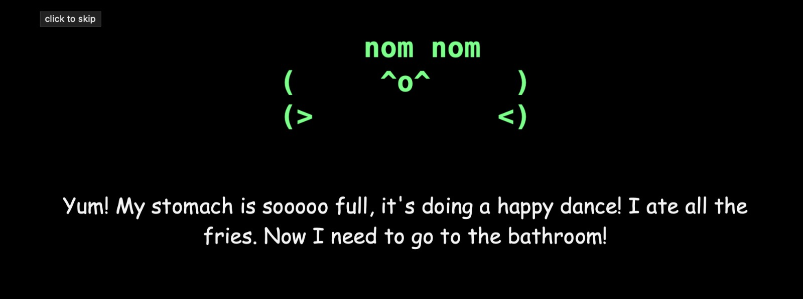

# Say hi to Bob!!



```
(     ^_^     )
(>           <)
```

Bob is a 5 and a half year old boy who lives inside a computer with his mom and dad. You can talk to him, feed him, poke him and tuck him into bed.

He loves chicken biryani and White Monster. He does NOT like veg biryani ("that's just pulao!"). If you're mean to him, he cries until you say sorry.

## What you need

- Python 3.0
- [Ollama](https://ollama.com), running, with Qwen3:4B pulled:
  ```
  ollama pull qwen3:4b
  ```
- tkinter, for Bob's window. Most Pythons come with it. If yours doesn't, Bob just opens in the terminal instead. On a Mac, you can get it with `brew install python-tk`.

Bob talks to Ollama at `http://localhost:11434`. You can change this in `config.py` :D

## Running Bob

**In his own window** (black screen, Bob in the middle, his reply typed out under him):
```
python3 main.py
```

**In the terminal:**
```
python3 main.py --text
```

**In your browser:**
```
python3 web.py
```
Then open http://localhost:7860. Everyone who opens the page gets their own Bob.

## Things you can type

There are six commands for Bob, you can view them with the /help command. (Which is one of them!)

Saying goodnight (or "so jao") also puts him to bed.

## Settings

Everything is in `config.py`. Feel free to customise the config file. While I have built him around qwen3:4b, feel free to change the AI model.

For example: `BOB_MODEL=qwen3:1.7b python3 main.py`

## Important note

Bob forgets everything after every session. Basically, clsosing and restarting him wipes his memory.

Please do give feedback!
